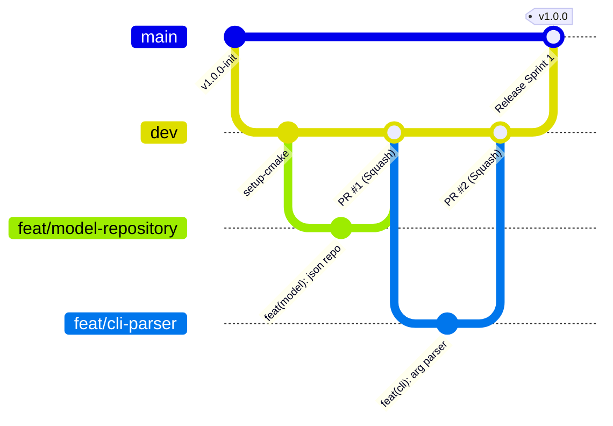

# Contributing & Git Governance Guide (`CONTRIBUTING.md`)

This guide defines the collaborative workflow, branching strategy, commit standards, and Pull Request (PR) protocols for the SnipCLI 2-person engineering team.

---

## 1. Branching Strategy (Lightweight GitHub Flow)

To ensure rapid iteration without branch decay or merge nightmares, we maintain two perpetual branches and ephemeral feature branches:



### Branch Roles
- **`main` (Production / Defense Ready):**
  - Always clean, compiles without warnings, passes 100% of tests.
  - Protected: Direct pushes forbidden. Merges only occur via PR from `dev` after full CI approval.
- **`dev` (Integration Branch):**
  - The working baseline where Developer A and Developer B integrate tested features.
  - Required CI checks must pass before merging.
- **`feat/<short-description>`:**
  - Short-lived feature branch created off `dev` (e.g., `feat/json-repository`, `feat/command-dispatcher`).
  - Merged into `dev` via PR and deleted immediately upon merge.
- **`fix/<short-description>`:**
  - Bug fixes created off `dev` (e.g., `fix/ansi-color-windows`, `fix/line-count-overflow`).

---

## 2. Commit Message Standard (Conventional Commits)

All commits must follow the **Conventional Commits v1.0.0** specification:

```
<type>(<scope>): <short imperative description>

[optional body explaining motivation and trade-offs]

[optional footer: Closes #issue]
```

### Allowed Types
- **`feat`**: A new user-facing feature or CLI command (e.g., `feat(command): implement stats command`).
- **`fix`**: A bug fix (e.g., `fix(parser): handle paths with spaces`).
- **`docs`**: Documentation only changes (e.g., `docs(readme): add installation guide`).
- **`refactor`**: Code change that neither fixes a bug nor adds a feature (e.g., `refactor(model): decouple search strategy`).
- **`test`**: Adding missing tests or correcting existing tests (e.g., `test(validator): add 100-line boundary tests`).
- **`ci`**: Changes to CI/CD workflows and build scripts (e.g., `ci(actions): add Windows matrix runner`).

### Concrete Examples
```bash
# Good
feat(model): implement json snippet repository with file locking
fix(view): reset ansi color codes on terminal view tear down
test(controller): add smoke tests for add and delete CLI verbs
docs(viva): add live modification playbook for final defense

# Bad
git commit -m "fixed stuff"
git commit -m "wip"
git commit -m "dev a finished part 2"
```

---

## 3. Pull Request Protocol & Review Rules

### 3.1 Mutual Code Review Invariant
- **Rule of 2:** Neither Lameya Tabasum nor Chowdhury Rifat Ahmed is permitted to merge their own PR. Every PR requires an explicit **"Approve"** review from the peer developer:
  - PRs submitted by **Lameya Tabasum** (`@lameyatabasum`) must be reviewed and approved by **Chowdhury Rifat Ahmed** (`@chowdhuryrifat`).
  - PRs submitted by **Chowdhury Rifat Ahmed** (`@chowdhuryrifat`) must be reviewed and approved by **Lameya Tabasum** (`@lameyatabasum`).
- Reviewer must verify:
  1. Does it build locally without warnings (`-Wall -Wextra -Wpedantic`)?
  2. Are all new classes accompanied by Doxygen docstrings?
  3. Does it violate MVC or SOLID boundaries?
  4. Is there zero memory leak / zero raw owning pointers?
- All PRs are merged using **Squash and Merge** to maintain a linear, clean commit history on `dev`.

### 3.2 Pull Request Template (`.github/pull_request_template.md`)

```markdown
### Summary of Changes
- Implemented ...
- Solves issue #...

### Layer Affected
- [ ] Model (`src/model/`)
- [ ] View (`src/view/`)
- [ ] Controller (`src/controller/`)
- [ ] Build / CI (`CMakeLists.txt`, `.github/`)

### Architecture & SOLID Compliance
- [ ] Adheres to MVC boundaries (No View code in Model, No Model queries in View)
- [ ] Zero raw owning pointers (`std::unique_ptr` / `std::shared_ptr` used)
- [ ] `const` correctness verified
- [ ] Include guards and `#pragma once` in all headers

### Verification
- [ ] Local build passes: `cmake --build build --target snip_tests`
- [ ] Unit tests pass: `ctest --test-dir build --output-on-failure`
- [ ] Memory checked: Valgrind / AddressSanitizer clean
```

---

## 4. Conflict Prevention: Zero-Collision Strategy

For a fast 7-day sprint between 2 developers, merge conflicts in C++ arise primarily from editing shared header files. SnipCLI prevents conflicts via the **Contract Freeze Protocol**:

1. **Day 1 Contract Freeze:** On Day 1, both developers (Lameya and Chowdhury Rifat) collaborate to finalize and merge all abstract header interfaces (`ISnippetRepository.hpp`, `ISnippetView.hpp`, `ICommand.hpp`, `Snippet.hpp`) into `dev`. Once merged, these headers are **FROZEN**.
2. **Strict File Ownership:**
   - **Chowdhury Rifat Ahmed's Domain (Backend / Core):** `include/snipcli/model/`, `src/model/`, `tests/unit/test_snippet.cpp`, `tests/unit/test_validator.cpp`, `tests/unit/test_repository.cpp`, `tests/unit/test_strategy.cpp`.
   - **Lameya Tabasum's Domain (Frontend / Routing & DevOps):** `include/snipcli/view/`, `include/snipcli/controller/`, `src/view/`, `src/controller/`, `tests/smoke/smoke_test.sh`, `.github/workflows/ci.yml`.
3. **No Cross-Editing:** If Lameya needs an additional method in Model, she requests an interface adjustment via a GitHub issue/PR rather than modifying Rifat's implementation files, and vice versa.
