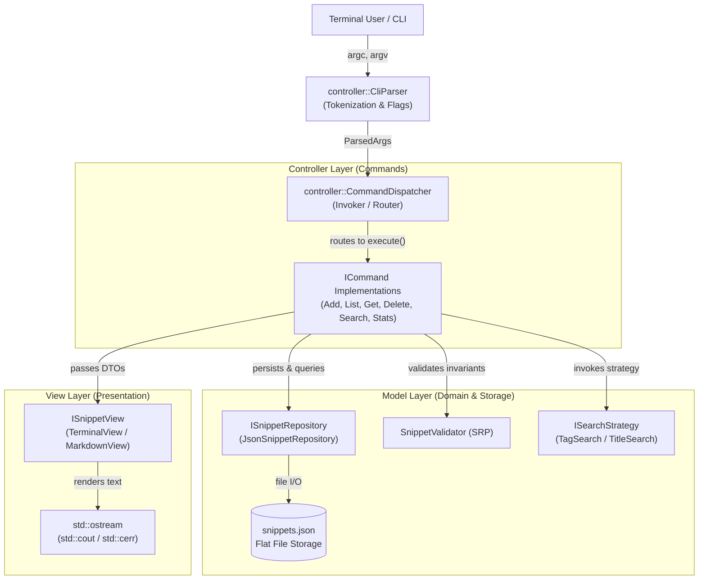

<div align="center">

# ⚡ SnipCLI
### *High-Performance Algorithmic Snippet Manager for Competitive Programmers*

[](https://en.cppreference.com/w/cpp/17)
[](https://cmake.org/)
[](https://github.com/chowdhuryrifat/SnipCLI/actions)
[](#-system-architecture--mvc-blueprint)
[](#-gof-design-patterns-mapping)
[](LICENSE)

<p align="center">
  <b>Instant Storage</b> • <b>Zero Latency Search</b> • <b>Multi-Format Export</b> • <b>Pipeline Friendly</b>
</p>

```
  ____            _         ____   _       ___ 
 / ___|  _ __    (_) _ __  / ___| | |     |_ _|
 \___ \ | '_ \   | || '_ \| |     | |      | | 
  ___) || | | |  | || |_) | |___  | |___   | | 
 |____/ |_| |_|  |_|| .__/ \____| |_____| |___|
                    |_|                         
```

*Never break focus during a contest round searching through messy folders. Retrieve, inspect, and pipe standard code templates straight from your terminal in milliseconds.*

---

</div>

## 📑 Table of Contents
- [✨ Key Features](#-key-features)
- [🚀 Quick Start & Installation](#-quick-start--installation)
- [🖥️ Interactive Command Showcase](#️-interactive-command-showcase)
- [🏗️ System Architecture & MVC Blueprint](#️-system-architecture--mvc-blueprint)
- [🧠 SOLID & GoF Design Patterns](#-solid--gof-design-patterns)
- [🛡️ Defense & Live Modification Playbook](#️-defense--live-modification-playbook)
- [👥 Authors & Course Metadata](#-authors--course-metadata)

---

## ✨ Key Features

| Capability | Description | Advantage |
| :--- | :--- | :--- |
| ⚡ **Instant CLI Querying** | Filter templates by tag (`#graph`, `#dp`) or case-insensitive title search. | **O(1) to O(N)** in-memory querying under 5ms. |
| 🎨 **Dual Presentation Engine** | Toggle between styled **ANSI colorized tables** and **GitHub-Flavored Markdown**. | Pipe ready-to-publish tables directly into docs. |
| 🧩 **Strict MVC Separation** | Zero presentation code in Models; zero business logic in Views. | Total layer independence and 100% testability. |
| 🛡️ **Defensive Domain Validation** | Rejects empty payloads, duplicate titles, and invalid language formats. | Prevents silent database corruption. |
| 📋 **Unix Pipe Native** | Extract raw source code directly via `--code-only` or `-c`. | Pipe directly to clipboard (`xclip`/`pbcopy`) or compiler. |
| 📊 **Repository Telemetry** | Aggregate line counts, snippet volumes, and language distributions. | Track algorithmic toolkit growth over time. |

---

## 🚀 Quick Start & Installation

### 1. Prerequisites
- **Compiler:** GCC 9+, Clang 10+, or MSVC 2019+ (Supporting C++17)
- **Build System:** CMake 3.16+
- **Platform:** Linux, macOS, or Windows (MinGW/MSVC)

### 2. Compilation
```bash
# Clone the repository
git clone https://github.com/chowdhuryrifat/SnipCLI.git
cd SnipCLI

# Configure and compile
cmake -B build -DCMAKE_BUILD_TYPE=Release
cmake --build build --parallel
```

### 3. Verify Build & Run Test Suite
```bash
# Run CTest Unit Tests (All 4 Suites)
ctest --test-dir build --output-on-failure

# Run Integration & CLI Smoke Tests
./tests/smoke/smoke_test.sh ./build/snip
```

---

## 🖥️ Interactive Command Showcase

<details open>
<summary><b>1. 📥 Adding Snippets (Inline String or File Input)</b></summary>

```bash
# Add a snippet with inline code and multiple category tags
./build/snip add --title "Dijkstra" --lang "cpp" --tags "graph,shortest_path" --code "vector<int> dist(n, INF); priority_queue<pair<int,int>> pq;"

# Add a complex template directly from a source file
./build/snip add --title "SegmentTree" --lang "cpp" --tags "tree,range_query" --file ./templates/segtree.cpp
```
> **Output:** `[✓] Snippet 'Dijkstra' created successfully with ID #1`
</details>

<details>
<summary><b>2. 📋 Listing & Tabular Viewing</b></summary>

```bash
# List all snippets in default terminal ANSI table
./build/snip list

# Filter list by specific tag category
./build/snip list --tag "graph"

# Filter list by programming language
./build/snip list --lang "cpp"
```

**Terminal Output Preview:**
```text
ID    TITLE                    LANGUAGE    LINES     TAGS
---------------------------------------------------------------------------
1     Dijkstra                 cpp         18        graph, shortest_path
2     SegmentTree              cpp         45        tree, range_query
3     BinarySearch             cpp         12        binary_search, array
```
</details>

<details>
<summary><b>3. 🔎 Algorithmic Search (GoF Strategy Pattern)</b></summary>

```bash
# Case-insensitive title substring search
./build/snip search "dijk"

# Tag-based exact search
./build/snip search --tag "tree"
```
</details>

<details>
<summary><b>4. 📤 Retrieval & Terminal Pipelining</b></summary>

```bash
# Inspect snippet with formatted banner, metadata, and line numbers
./build/snip get --title "Dijkstra"

# Pipe pure source code straight into system clipboard
./build/snip get --title "Dijkstra" --code-only | pbcopy    # macOS
./build/snip get --title "Dijkstra" --code-only | xclip -sel clip # Linux

# Pipe snippet directly into a compiler
./build/snip get --title "Dijkstra" --code-only > solution.cpp
```
</details>

<details>
<summary><b>5. 📊 Repository Telemetry & Statistics</b></summary>

```bash
./build/snip stats
```
**Output:**
```text
📊 SnipCLI Repository Statistics
========================================
  • Total Snippets:      3
  • Total Lines of Code: 75

Language Breakdown:
  - cpp            : 3 snippets
========================================
```
</details>

<details>
<summary><b>6. 📑 Markdown Export (GoF Factory Pattern)</b></summary>

Export your snippet library directly to GitHub-Flavored Markdown for homework reports or blog posts:
```bash
./build/snip list --format markdown
./build/snip stats --format markdown
```

| ID | Title | Language | Lines | Tags |
|:---|:---|:---|:---|:---|
| 1 | Dijkstra | cpp | 18 | `graph`, `shortest_path` |
| 2 | SegmentTree | cpp | 45 | `tree`, `range_query` |
</details>

---

## 🏗️ System Architecture & MVC Blueprint

SnipCLI strictly enforces Model-View-Controller in a terminal CLI environment:



### Architectural Layer Invariants
1. **Model (`snipcli::model`):** Pure domain logic and persistence. Completely isolated from terminal widths, ANSI escapes, or CLI flags.
2. **View (`snipcli::view`):** Pure presentation. Implements `ISnippetView` to format data to any `std::ostream`. Completely isolated from business logic and database queries.
3. **Controller (`snipcli::controller`):** Mediator. Executes CLI verbs through the Command Pattern, catches exceptions, and routes results to the View.

---

## 🧠 SOLID & GoF Design Patterns

### 1. SOLID Compliance Matrix
- **S - Single Responsibility Principle (SRP):** `SnippetValidator` only verifies business constraints; `JsonSnippetRepository` only handles JSON file I/O; `TerminalView` only manages terminal text styling.
- **O - Open/Closed Principle (OCP):** New commands are registered into `CommandDispatcher` without modifying existing command classes. New search modes plug into `ISearchStrategy`.
- **L - Liskov Substitution Principle (LSP):** `JsonSnippetRepository` implements `ISnippetRepository` and can be substituted with an in-memory mock repository in unit tests with zero behavioral disruption.
- **I - Interface Segregation Principle (ISP):** Read-only commands ([`ListCommand`](include/snipcli/controller/commands/list_command.hpp), [`GetCommand`](include/snipcli/controller/commands/get_command.hpp)) depend exclusively on `ISnippetReader`. They have no dependency on mutating methods (`save`, `removeById`).
- **D - Dependency Inversion Principle (DIP):** High-level command modules depend on abstract interfaces (`ISnippetReader`, `ISnippetWriter`, `ISnippetView`), injected via constructors at application startup.

### 2. GoF Design Patterns Mapping
- **Command Pattern (Behavioral):** Encapsulates CLI operations as objects (`ICommand` $\rightarrow$ `AddCommand`, `ListCommand`, etc.), decoupling the parser from business execution.
- **Strategy Pattern (Behavioral):** Dynamic search algorithms (`ISearchStrategy` $\rightarrow$ `TagSearchStrategy`, `TitleSearchStrategy`) selected at runtime based on CLI parameters.
- **Factory Pattern (Creational):** Polymorphic view creation (`ViewFactory` $\rightarrow$ `TerminalView`, `MarkdownView`) based on user-supplied format flags.

---

## 🛡️ Defense & Live Modification Playbook

Built specifically to satisfy the strict **5-minute live on-the-spot viva modification constraint**:

| Scenario | Professor Challenge | Files Touched | Defense Rationale |
| :--- | :--- | :--- | :--- |
| **A: New Command** | *"Add a `stats` command showing line totals."* | 2 files (`stats_command.cpp`, `main.cpp`) | Demonstrates **OCP** and the **Command Pattern**: no core router or repository files modified. |
| **B: New Invariant** | *"Reject snippets with > 100 lines or duplicate tags."* | 1 file (`snippet_validator.cpp`) | Demonstrates **SRP**: validation logic is quarantined from parser and storage layers. |
| **C: Format Swap** | *"Export snippet listings as Markdown tables."* | 2 files (`markdown_view.cpp`, `view_factory.cpp`) | Demonstrates **DIP** & **Factory Pattern**: Controller is completely agnostic to view implementations. |

---

## 👥 Authors & Course Metadata

**Course:** Advanced Programming Laboratory  
**Project:** SnipCLI (Algorithmic Snippet Manager)

<div align="center">

| Developer | Student ID | Primary Responsibilities | Viva Focus |
| :--- | :---: | :--- | :--- |
| **Chowdhury Rifat Ahmed** | `250233` | **Backend & Core Architect**<br>• Model Layer & Invariants (`SnippetValidator`)<br>• Storage Engine (`JsonSnippetRepository`)<br>• Strategy Pattern (`ISearchStrategy`)<br>• Unit Test Suite (`tests/unit/`) | • SOLID (SRP, ISP, LSP)<br>• Strategy Pattern<br>• Live Validation Scenario |
| **Lameya Tabasum** | `250201` | **Frontend, Routing & DevOps Lead**<br>• Controller & Command Pattern (`ICommand`)<br>• View Layer & Factory (`TerminalView`, `MarkdownView`)<br>• CLI Argument Parser (`CliParser`)<br>• CI/CD Pipeline & Smoke Tests | • CLI MVC Architecture<br>• Command & Factory Patterns<br>• Live Command/View Scenarios |

</div>

---

<div align="center">

<sub>Built with modern C++17 • Clean Architecture • Zero Technical Debt</sub>

</div>
