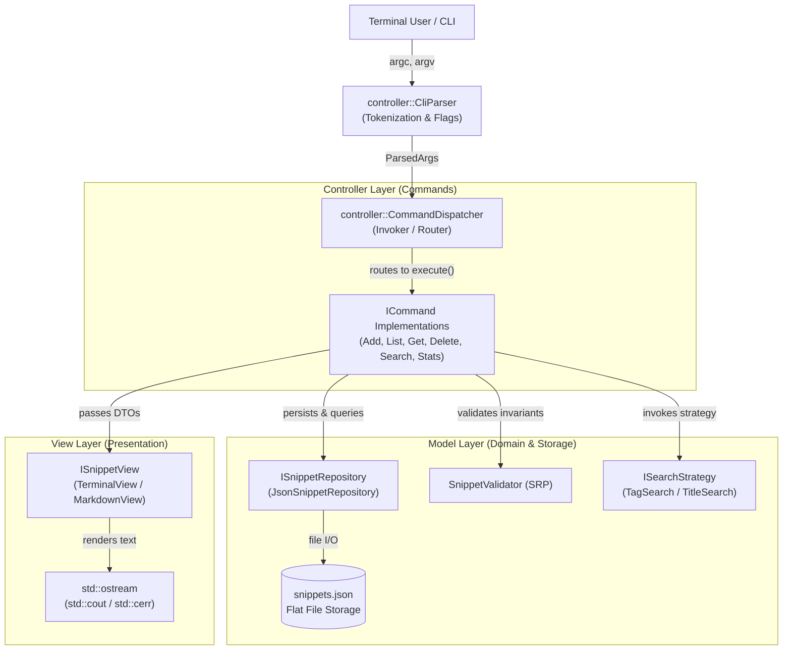

<div align="center">

# ⚡ SnipCLI
### *High-Performance Algorithmic Snippet Manager for Competitive Programmers*

[](https://en.cppreference.com/w/cpp/17)
[](https://cmake.org/)
[](https://github.com/chowdhuryrifat/SnipCLI/actions)
[](https://github.com/chowdhuryrifat/SnipCLI)
[](#-system-architecture--mvc-blueprint)
[](#-gof-design-patterns-mapping)
[](https://github.com/chowdhuryrifat/SnipCLI/releases)
[](LICENSE)

<p align="center">
  <b>Instant Storage</b> • <b>Zero Latency Search</b> • <b>Multi-Format Export</b> • <b>Pipeline Friendly</b>
</p>

```
  ____            _         ____   _       ___ 
 / ___|  _ __    (_) _ __  / ___| | |     |_ _|
 \___ \ | '_ \   | || '_ \| |     | |      | | 
  ___) || | | |  | || |_) | |___  | |___   | | 
 |____/ |_| |_|  |_|| .__/ \____| |_____| |___|
                    |_|                         
```

*Never break focus during a contest round searching through messy folders. Retrieve, inspect, and pipe standard code templates straight from your terminal in milliseconds.*

---

</div>

## 📑 Table of Contents
- [✨ Key Features](#key-features)
- [🚀 Quick Start & Installation](#quick-start--installation)
- [🖥️ Interactive Command Showcase](#interactive-command-showcase)
- [📖 Complete CLI Command & Option Reference](#complete-cli-command--option-reference)
- [⚙️ Configuration & Environment](#configuration--environment)
- [🏗️ System Architecture & MVC Blueprint](#system-architecture--mvc-blueprint)
- [🧠 SOLID & GoF Design Patterns](#solid--gof-design-patterns)
- [🧪 Automated Testing & CI/CD Pipeline](#automated-testing--cicd-pipeline)
- [🎓 Course Defense & Authors Metadata](docs/internal/COURSE.md)

---

## ✨ Key Features

| Capability | Description | Advantage |
| :--- | :--- | :--- |
| ⚡ **Instant CLI Querying** | Filter templates by tag (`#graph`, `#dp`), language (`cpp`, `python`), or case-insensitive title search. | **O(1) to O(N)** in-memory querying under 5ms. |
| 🎨 **Dual Presentation Engine** | Toggle between styled **ANSI colorized tables** and **GitHub-Flavored Markdown**. | Pipe ready-to-publish tables directly into docs. |
| 🧩 **Strict MVC Separation** | Zero presentation code in Models; zero business logic in Views. | Total layer independence and 100% testability. |
| 🛡️ **Defensive Domain Validation** | Rejects empty payloads, duplicate titles, and invalid language formats. | Prevents silent database corruption. |
| 📋 **Unix Pipe Native** | Extract raw source code directly via `--code-only` or `-c`. | Pipe directly to clipboard (`xclip`/`pbcopy`) or compiler. |
| 📊 **Repository Telemetry** | Aggregate line counts, snippet volumes, and sorted language distributions. | Track algorithmic toolkit growth over time. |

---

## 🚀 Quick Start & Installation

### 1. Prebuilt Binaries (Recommended)

Standalone, statically-linked executables for Linux (x86_64), macOS (Universal: Apple Silicon & Intel), and Windows (x86_64) are attached to every [GitHub Release](https://github.com/chowdhuryrifat/SnipCLI/releases) accompanied by cryptographic checksums (`SHA256SUMS.txt`) and build provenance attestations:

```bash
# Example: Download and run on Linux x86_64
curl -fsSLO https://github.com/chowdhuryrifat/SnipCLI/releases/download/v1.0.0/snipcli-v1.0.0-linux-x86_64.tar.gz
tar -xzf snipcli-v1.0.0-linux-x86_64.tar.gz
./bin/snip --version
```

### 2. Build from Source

Build SnipCLI with zero external dependencies in 3 commands:

```bash
git clone https://github.com/chowdhuryrifat/SnipCLI.git
cmake -S SnipCLI -B build -DCMAKE_BUILD_TYPE=Release
cmake --build build -j"$(nproc)"
```

#### Run Verification Test Suite:

```bash
# Run CTest Unit Tests (All 7 Suites - 139 Scenarios & Invariants)
ctest --test-dir build --output-on-failure

# Run Automated End-to-End Smoke & Integration Tests
./tests/smoke/smoke_test.sh ./build/snip
```

### 3. Package Managers (Coming soon — available after the v1.0.0 release is published)

Once the release is published and upstream registry PRs are accepted, SnipCLI will be installable via standard package managers:

```bash
# macOS & Linux (Homebrew) — Coming Soon
brew tap chowdhuryrifat/snipcli
brew install snipcli

# Windows (WinGet) — Coming Soon
winget install ChowdhuryRifat.SnipCLI

# Debian / Ubuntu (.deb via Releases or PPA) — Coming Soon
sudo dpkg -i snipcli_1.0.0_amd64.deb

# Arch Linux (AUR) — Coming Soon
yay -S snipcli
```

---

## 🖥️ Interactive Command Showcase

<details open>
<summary><b>1. 📥 Adding Snippets (Inline String or File Input)</b></summary>

```bash
# Add a snippet with inline code and multiple category tags
./build/snip add --title "Dijkstra" --lang "cpp" --tags "graph,shortest_path" --code "vector<int> dist(n, INF); priority_queue<pair<int,int>> pq;"

# Add code starting with hyphens or comments using equals syntax
./build/snip add --title "SqlComment" --lang "sql" --code="-- comment starting with dashes"

# Add a complex template directly from a source file
./build/snip add --title "SegmentTree" --lang "cpp" --tags "tree,range_query" --file ./templates/segtree.cpp
```
> **Output:** `[✓] Snippet 'Dijkstra' created successfully with ID #1`
</details>

<details>
<summary><b>2. 📋 Listing & Tabular Viewing</b></summary>

```bash
# List all snippets in default terminal ANSI table
./build/snip list

# Filter list by specific tag category
./build/snip list --tag "graph"

# Filter list by programming language
./build/snip list --lang "cpp"
```

**Terminal Output Preview:**
```text
ID    TITLE                    LANGUAGE    LINES     TAGS
---------------------------------------------------------------------------
1     Dijkstra                 cpp         18        graph, shortest_path
2     SegmentTree              cpp         45        tree, range_query
3     BinarySearch             cpp         12        binary_search, array
```
</details>

<details>
<summary><b>3. 🔎 Algorithmic Search (GoF Strategy Pattern)</b></summary>

```bash
# Case-insensitive title substring search
./build/snip search "dijk"

# Tag-based exact search
./build/snip search --tag "tree"

# Language-based exact search (LanguageSearchStrategy)
./build/snip search --lang "cpp"
```
</details>

<details>
<summary><b>4. 📤 Retrieval & Terminal Pipelining</b></summary>

```bash
# Inspect snippet with formatted banner, metadata, and line numbers
./build/snip get --title "Dijkstra"

# Retrieve snippet by numeric ID
./build/snip get --id 1

# Pipe pure source code straight into system clipboard
./build/snip get --title "Dijkstra" --code-only | pbcopy    # macOS
./build/snip get --title "Dijkstra" --code-only | xclip -sel clip # Linux

# Pipe snippet directly into a compiler
./build/snip get --title "Dijkstra" --code-only > solution.cpp
```
</details>

<details>
<summary><b>5. 📊 Repository Telemetry & Statistics</b></summary>

```bash
./build/snip stats
```
**Output:**
```text
📊 SnipCLI Repository Statistics
========================================
  • Total Snippets:      3
  • Total Lines of Code: 75

Language Breakdown:
  - cpp            : 3 snippets
========================================
```
</details>

<details>
<summary><b>6. 📑 Markdown Export (GoF Factory Pattern)</b></summary>

Export your snippet library directly to GitHub-Flavored Markdown for homework reports or blog posts:
```bash
./build/snip list --format markdown
./build/snip stats --format markdown
```

| ID | Title | Language | Lines | Tags |
|:---|:---|:---|:---|:---|
| 1 | Dijkstra | cpp | 18 | `graph`, `shortest_path` |
| 2 | SegmentTree | cpp | 45 | `tree`, `range_query` |
</details>

<details>
<summary><b>7. 🗑️ Snippet Deletion & Mutation</b></summary>

```bash
# Delete snippet by unique title
./build/snip delete --title "Dijkstra"

# Delete snippet by numeric ID
./build/snip delete --id 1

# Delete snippet via positional query
./build/snip delete "BinarySearch"
```
> **Output:** `> **Success:** Snippet 'Dijkstra' deleted successfully.`
</details>

---

## 📖 Complete CLI Command & Option Reference

| Verb | Syntax | Flags & Options | Description |
| :--- | :--- | :--- | :--- |
| `add` | `snip add --title <t> --lang <l> [--code <c> \| --file <f>] [--tags <t1,t2>]` | `--title`<br>`--lang, --language`<br>`--code`<br>`--file`<br>`--tags, --tag` | Persists a new code snippet with strict domain validation. |
| `list` | `snip list [--tag <tag>] [--lang <lang>] [--format <fmt>]` | `--tag, --tags`<br>`--lang, --language`<br>`--format` (`terminal` \| `markdown`) | Displays tabular snippet library with optional category/language filters. |
| `get` | `snip get [--title <t> \| --id <id> \| <query>] [--code-only] [--format <fmt>]` | `--title`<br>`--id`<br>`--code-only, -c`<br>`--format` | Retrieves and inspects a snippet; `--code-only` outputs pure source for pipes. |
| `search` | `snip search [<query>] [--tag <tag>] [--lang <lang>] [--format <fmt>]` | `--tag, --tags`<br>`--lang, --language`<br>`--format` | Dynamic GoF Strategy search across substrings, tags, or languages. |
| `stats` | `snip stats [--format <fmt>]` | `--format` (`terminal` \| `markdown`) | Computes repository telemetry, total line count, and sorted language metrics. |
| `delete` | `snip delete [--title <t> \| --id <id> \| <query>] [--format <fmt>]` | `--title`<br>`--id`<br>`--format` | Deletes a snippet by title or ID with verification and clean error reporting. |

**Global Options:**
- `--help, -h`: Display command-line manual and option syntax.
- `--version, -v`: Display application name and semantic version.
- `--format <terminal|markdown>`: Globally override presentation engine format.

> **Note on CLI Options & Aliases:** Single-dash value aliases (`-t`, `-l`, `-f`, and `-c` in `add`) are supported and strictly mapped to their corresponding long options (`--title`, `--lang`, `--file`, `--code`). In `get`, `-c` functions as the pipe-native `--code-only` boolean flag. Global options (`--format`, `--help`, `--version`) may precede or follow the command verb. Options are strictly validated per command schema to guarantee unknown or unsupported options are rejected prior to execution. Valueless options and unquoted multi-word arguments are defensively rejected with explicit diagnostic errors. Standard end-of-options delimiter (`--`) is fully supported.

---

## ⚙️ Configuration & Environment

SnipCLI operates with sensible zero-configuration defaults, but can be customized through environment variables:

| Environment Variable | Allowed Values / Range | Default | Purpose |
|---|---|---|---|
| `SNIPCLI_STORAGE_PATH` | Any valid absolute or relative file path | `~/.snipcli/snippets.json` | Specifies the storage file location for snippets. Directory is auto-created if missing. |
| `SNIPCLI_LOCK_TIMEOUT_MS` | Integer in range `[1, 600000]` ms (1 ms to 10 min) | `10000` (10 seconds) | Maximum polling time to acquire the cross-process storage lock before failing with exit code 1. Non-numeric or out-of-range values fall back safely to default. |
| `NO_COLOR` | Any non-empty string | *(unset)* | Disables ANSI color codes on terminal output per the [NO_COLOR specification](https://no-color.org/). |

---

## 🏗️ System Architecture & MVC Blueprint

SnipCLI strictly enforces Model-View-Controller in a terminal CLI environment:



### Architectural Layer Invariants
1. **Model (`snipcli::model`):** Pure domain logic and persistence. Completely isolated from terminal widths, ANSI escapes, or CLI flags.
2. **View (`snipcli::view`):** Pure presentation. Implements `ISnippetView` to format data to any `std::ostream`. Completely isolated from business logic and database queries.
3. **Controller (`snipcli::controller`):** Mediator. Executes CLI verbs through the Command Pattern, catches exceptions, and routes results to the View.
4. **Storage Concurrency & Integrity:** In-process thread-safety guarded by `std::mutex`, cross-process writer exclusion guarded by advisory `<storagePath>.lock` (`flock` on POSIX with `O_NOFOLLOW`, `LockFileEx` on Windows) with bounded timeout (default 10s, configurable via `SNIPCLI_LOCK_TIMEOUT_MS` in range `[1, 600000]` ms with safe bounds clamping and default fallback), POSIX parent directory `fsync` and macOS `F_FULLFSYNC` durability, lock-free reader operations over atomic file replacement, strict UTF-8 validation, closed schema enforcement (unknown fields are validated on read and dropped upon write; preservation is scheduled for v1.1), and sequential ID allocation (IDs are assigned as highest existing ID + 1 and can be reused after deleting the newest snippet; use titles for stable references).

---

## 🧠 SOLID & GoF Design Patterns

### 1. SOLID Compliance Matrix
- **S - Single Responsibility Principle (SRP):** `SnippetValidator` only verifies business constraints; `JsonSnippetRepository` only handles JSON file I/O; `TerminalView` only manages terminal text styling.
- **O - Open/Closed Principle (OCP):** New commands are registered into `CommandDispatcher` without modifying existing command classes. New search modes plug into `ISearchStrategy`.
- **L - Liskov Substitution Principle (LSP):** `JsonSnippetRepository` implements `ISnippetRepository` and can be substituted with an in-memory mock repository in unit tests with zero behavioral disruption.
- **I - Interface Segregation Principle (ISP):** Read-only commands ([`ListCommand`](include/snipcli/controller/commands/list_command.hpp), [`GetCommand`](include/snipcli/controller/commands/get_command.hpp)) depend exclusively on `ISnippetReader`. They have no dependency on mutating methods (`save`, `removeById`).
- **D - Dependency Inversion Principle (DIP):** High-level command modules depend on abstract interfaces (`ISnippetReader`, `ISnippetWriter`, `ISnippetView`), injected via constructors at application startup.

### 2. GoF Design Patterns Mapping
- **Command Pattern (Behavioral):** Encapsulates CLI operations as objects (`ICommand` $\rightarrow$ `AddCommand`, `ListCommand`, `GetCommand`, `DeleteCommand`, `SearchCommand`, `StatsCommand`), decoupling the CLI argument parser from domain business execution.
- **Strategy Pattern (Behavioral):** Dynamic algorithmic search strategies (`ISearchStrategy` $\rightarrow$ `TagSearchStrategy`, `TitleSearchStrategy`, `LanguageSearchStrategy`) dynamically bound at runtime based on CLI flags, eliminating nested conditional logic.
- **Factory Pattern (Creational):** Polymorphic view creation (`ViewFactory` $\rightarrow$ `TerminalView`, `MarkdownView`) based on user-supplied format flags, featuring standard and custom stream injection for 100% test isolation.

---

## 🧪 Automated Testing & CI/CD Pipeline

SnipCLI enforces rigorous multi-layered quality gates across every commit and Pull Request:

### 1. Multi-Suite Unit Testing (CTest)
A lightweight zero-dependency modern unit testing framework validates 7 comprehensive suites spanning 139 domain invariants and behavioral scenarios:
- **`Snippet` (10 Invariants):** Immutability, line counting, tag normalization, ISO 8601 timestamps.
- **`SnippetValidator` (12 Invariants):** Defense against empty titles, illegal characters, empty languages, and missing payloads.
- **`JsonSnippetRepository` (25 Scenarios & Invariants):** CRUD operations, ID auto-incrementation, persistence roundtrips, corrupted JSON quarantine, Unicode decoding, atomic file replacement, multi-line CRLF preservation, cross-process advisory lock synchronization with bounded timeout, duplicate-title rejection, symlink loop/recursion depth limit defense, unknown field validation with closed schema drop-on-save characterization, max(id)+1 ID allocation and reuse on deletion characterization, lock file symlink hardening (`O_NOFOLLOW`) with stale lock resilience, and `SNIPCLI_LOCK_TIMEOUT_MS` bounds clamping with held-lock timeout measurement.
- **`Strategy Pattern` (10 Scenarios):** Case-insensitive title substring, exact tag matching, and language filtering.
- **`CliParser` & `CommandDispatcher` (31 Invariants):** Tokenization, short/long flags, positional arguments, standalone flag isolation, spaced negative values, valueless option schema validation, global options before verb, `--` delimiter, strict unknown option rejection, command-specific option schema enforcement, and boolean flag equals-syntax rejection.
- **`Command Wiring` (31 Scenarios):** Mocked verification of `add`, `list`, `get`, `delete`, `search`, and `stats` execution, including strict ID parsing, multi-word argument defense, add-command positional quarantine, unknown option state protection, command-specific option rejection state protection, mutually exclusive selector enforcement, and storage exception quarantine.
- **`View Engine & Factory` (20 Scenarios):** Stream-injected verification of `TerminalView`, `MarkdownView`, `ViewFactory`, byte-exact `renderRaw`, cross-platform CRLF/LF stream identity, and `NO_COLOR` color suppression.

### 2. Automated End-to-End Smoke & Integration Suite
The bash test suite (`tests/smoke/smoke_test.sh`) verifies the final binary end-to-end:
- Full CLI verb lifecycle (`add`, `list`, `get`, `search`, `stats`, `delete`).
- Dual presentation engines (ANSI terminal formatting vs GitHub-Flavored Markdown).
- Pipe-native extraction (`--code-only`) ensuring zero extraneous metadata leaks into shell pipes.
- Error quarantine: cleanly exits with non-zero exit codes upon duplicate titles, invalid verbs, missing IDs, unquoted multi-word positionals, or unsupported command options.
- Cross-process concurrency: 20 parallel adds and race safety verified without lost updates.
- Isolated environment resilience: `--help` execution under stripped environment (containers, cron, `env -i`).
- Cross-platform path normalization (`cygpath`) for seamless execution across Linux, macOS, and Windows Git Bash.

### 3. GitHub Actions CI/CD Matrix
Every pull request targeting `main` or `dev` triggers the automated CI/CD pipeline:
- **Code Quality & Static Analysis:** Clang-Format 18 check (`git diff --exit-code`) and Cppcheck static analysis (`--enable=warning,performance,portability --error-exitcode=1`).
- **Build & Test Matrix:** Parallel compilation, CTest execution, and automated smoke & adversarial test suites across `ubuntu-24.04` (GCC), `ubuntu-24.04` (GCC-Sanitizers with ASan + UBSan), `ubuntu-24.04` (GCC-TSan with `setarch x86_64 -R`), `macos-14` (AppleClang), and `windows-latest` (MSVC).
- **Adversarial Audit Reproduction:** Reproduction script (`scripts/snipcli_audit_repro.sh`) validating adversarial edge cases and cross-platform CRLF/LF byte-exact roundtrips across all operating systems.
- **Automated Artifact Packaging:** Production binaries are automatically archived and published as CI build artifacts.

---

## 📚 Documentation & Reference Guides

- [System Architecture](docs/ARCHITECTURE.md) — Detailed MVC layer responsibilities and GoF pattern design.
- [Technical Specification](docs/TECHNICAL.md) — Storage engine, locking mechanics, and JSON schema invariants.
- [Release Guide](docs/RELEASING.md) — Step-by-step checklist for tagging and release automation.
- [Downstream Packaging Guide](docs/PACKAGING.md) — Instructions for Homebrew, Debian, WinGet, and AUR maintainers.
- [Changelog](CHANGELOG.md) — Semantic version history, fixes, and release notes.
- [Contributing Guide](CONTRIBUTING.md) — Development setup, testing workflows, and PR protocols.
- [Security Policy](SECURITY.md) — Vulnerability reporting instructions and response SLAs.
- [Course & Defense Metadata](docs/internal/COURSE.md) — Defense playbook, 5-minute live modification scenarios, and course rubrics.

---

## 👥 Authors & Academic Credits

SnipCLI was developed by **Chowdhury Rifat Ahmed** (ID: `@chowdhuryrifat`) and **Lameya Tabasum** (ID: `@lameyatabasum`) for the Competitive Programming course.

For the live viva defense breakdown, 5-minute modification playbook, and grading evaluation rubrics, refer to [**Course & Viva Defense Metadata**](docs/internal/COURSE.md).

---

<div align="center">

<sub>Built with modern C++17 • Clean Architecture • Zero Technical Debt</sub>

</div>
